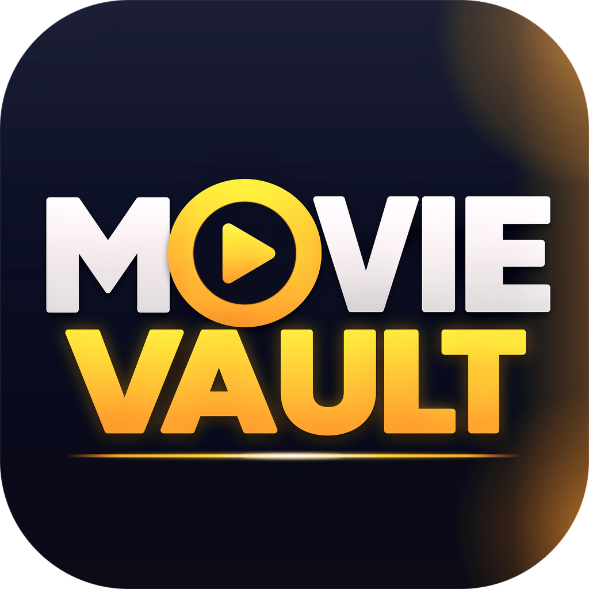

  

<h1 align="center">Movie Vault</h1>

  A personal tracker for movies and web series. Keep your watchlist, mark what you have watched, follow every episode, and never miss a new release.

  
  

  <a href="https://github.com/yourmostak2/movievaultapp/releases/tag/v1.4.2"><b>⬇️ Download the APK</b></a>
  &nbsp;·&nbsp;
  <a href="https://yourmostak2.github.io/movie-vault-site/">Website</a>
  &nbsp;·&nbsp;
  <a href="https://yourmostak2.github.io/movie-vault-site/privacy.html">Privacy Policy</a>
  &nbsp;·&nbsp;
  <a href="CHANGELOG.md">Changelog</a>

---

## What is Movie Vault?

Movie Vault is a free Android app that puts everything you watch in one place. Search any movie or series, save it to a list, tick off episodes as you go, and see what just landed in theaters or on streaming. Your lists follow you to a new phone through your account or your own Google Drive.

It covers **Hollywood, Bollywood, Tollywood and Dhallywood**, and works in **9 languages**.

## Features

### Your lists
- **Watchlist, Watched and Favorites** for movies and web series
- **Season and episode tracking.** See exactly how many episodes you have watched
- **Quick actions** from any card or details page

### Discover
- **Home page** with today's charts, new releases and a Top 10
- **In Theaters** and **New on OTT** categories, with the newest titles first
- **Details pages** with poster, rating, director, cast, genres and where to watch
- **Cast pages** to browse a person's other work
- **Search** across the built-in catalog and the whole TMDB database

### Never lose your lists
- **Account sync.** Sign in on another phone and everything is there
- **Google Drive backup.** Stored in a hidden app folder that only Movie Vault can see
- **Backup with words.** Copy your lists as plain words, keep them in Notes, paste them back to restore
- **Delete my account** erases your account and your saved data

### Made for everyday use
- **Light, Dark or System** appearance
- **9 languages:** English, Bengali, Hindi, Tamil, Telugu, Urdu, Arabic, Spanish and French
- **Built-in update checker** with release notes
- **No ads.** No tracking for advertising

## Download

> **First time here?**
> 1. Open the [latest release](https://github.com/yourmostak2/movie-vault-site/releases/latest) and download **MovieVault.apk**.
> 2. Open the file. If your phone asks, allow installs from your browser or file manager (**Settings → Install unknown apps**).
> 3. Tap **Install**, open Movie Vault, and register or sign in.

Movie Vault needs Android 6.0 or newer and an internet connection to load movie information. Your lists open without a connection.

Once installed, new versions appear inside the app under **Settings → Check for updates**.

## How backups work

| Method | Where it lives | Best for |
|---|---|---|
| **Account** | Your Movie Vault account | Automatic, always up to date |
| **Google Drive** | Hidden app folder in your Drive | A second copy you control |
| **Words** | Text you keep yourself (Notes, Telegram) | Offline, no account needed |

**Google Drive backup:** Open **Settings → Google Drive backup → Sign in with Google**. Google asks whether Movie Vault may use its own hidden folder in your Drive. Tick the Drive permission and continue. After that the app backs up by itself every few hours, and **Restore from backup** brings everything back on a new phone.

## FAQ

### Q: Is Movie Vault free?
Yes. It is free, has no ads and no in-app purchases.

### Q: Do I need an account?
You create a simple account to open the app. The account is also what keeps your lists safe if you change phones.

### Q: Where is my data stored?
Your lists are stored on your phone and, if you are signed in, in your own account. Google Drive backups live in a hidden folder in your Drive that only this app can open. Nothing is sold or used for ads. Read the [Privacy Policy](https://yourmostak2.github.io/movie-vault-site/privacy.html) for details.

### Q: Google says "Google hasn't verified this app". Is it safe?
Movie Vault only asks for access to its own hidden app folder and your email address. Google shows the warning for every new app that has not completed full review. Tap **Advanced → Go to Movie Vault** to continue.

### Q: The app will not install. It says "package conflicts".
You have an older test build with a different signature. Uninstall it once, then install the latest version. Your lists come back when you sign in or restore a backup. After that, every update installs over your current app.

### Q: How do I update?
Open **Settings → Check for updates**. If a newer version exists you will see the release notes and a Download button.

### Q: Can I delete my data?
Yes. **Profile → Delete account** removes your account and saved lists. To remove a Drive backup, sign out of Google in the app and remove Movie Vault from your Google Account's third-party access page.

### Q: I found a bug or have an idea.
Please [open an issue](https://github.com/yourmostak2/movie-vault-site/issues). Tell us your phone model and what happened.

## Credits

- Movie and series information and images are provided by [TMDB](https://www.themoviedb.org/).
- Built with [Capacitor](https://capacitorjs.com/).
- Accounts use Google Firebase. Backups use the Google Drive API.
- Made by [yourmostak2](https://github.com/yourmostak2).

## Disclaimer

*This product uses the TMDB API but is not endorsed or certified by TMDB.*
Movie Vault is an independent project and is not affiliated with any streaming service, studio or film database. Ratings and availability come from public sources and can differ from the official ones.
